<p align="center">
  
</p>

# PD2 Trader 中文版

**游戏内装备查价、中文交易市场、买卖聊天、物品上架与仓库估值，一份安装包同时兼容英文和汉化游戏客户端。**

> **特别感谢原作者 [errolgr](https://github.com/errolgr) 及所有 PD2 Trader 贡献者！**
>
> 本中文版基于 **[errolgr/pd2-trade](https://github.com/errolgr/pd2-trade)** 的开源成果进行中文本地化与兼容修复。原作者的工作是本项目的基础。
>
> **汉化作者：Solaris · 开源许可：[MIT License](LICENSE)**。保留原项目版权声明与许可证。

**[下载 Windows x64 安装包](https://github.com/SolairsVIP/pd2-trader-chinese/releases/download/v0.11.4/PD2.Trader.CN_0.11.4_x64-setup.exe) · [完整图文 PDF](https://github.com/SolairsVIP/pd2-trader-chinese/releases/download/v0.11.4/PD2.Trader.CN_User.Guide.pdf) · [发布页面](https://github.com/SolairsVIP/pd2-trader-chinese/releases/tag/v0.11.4)**

当前版本：**0.11.4 正式版**，发布于 2026-10-25。插件界面为中文，无需为两种游戏客户端分别安装或手动切换语言。

本版新增游戏右下角浮窗的**交易大厅入口**，位于聊天图标上方，点击即可打开市场；修复古尔等全部 33 种中文符文及同类条目的识别，并保留 0.11.3 的上架、搜索与提示汉化修复。[完整更新说明](docs/releases/v0.11.4.md)。

## 快速开始

1. 完全退出旧版程序及托盘进程，再安装上方的 Windows x64 安装包。
2. 启动插件，使用 PD2 账号登录，在浏览器中完成官方授权。
3. 从右下角托盘右键打开**设置**，核对游戏目录、赛季、天梯与普通／专家模式。
4. 回到游戏，将鼠标指向装备，按 **<kbd>Ctrl</kbd> + <kbd>D</kbd> 查价**；按 **<kbd>Ctrl</kbd> + <kbd>M</kbd> 打开交易大厅**；也可直接点击游戏右下角浮窗最上方的**商店图标**。

**0.11.2 及以上版本可通过自动更新升级；更早版本请手动安装当前正式版。默认自动检查中文版更新并弹出中文提示，由用户点击“下载并安装”后才更新及重启。** 在“设置 → 更新”中可以关闭自动检查或随时手动检查。启动约 5 秒后检查一次，运行中每隔 30 分钟检查一次；需要能连接 GitHub。安装后请核对现有账号和游戏分区设置。

本文将原 PDF 整理为可直接阅读的图文说明。截图及 PDF 来自原使用指南，旧图中“关闭自动更新”的说明已由 0.11.2 的更新设置取代，部分译名、按钮和设置可能与新版略有不同；**快捷键与行为以当前程序设置及本文说明为准**。[查看仓库内 PDF 原件](docs/PD2查价器中文版功能介绍.pdf)。

**阅读导航：**[登录](#1-登录并关联-pd2-账号) · [设置](#2-设置游戏目录与账号分区) · [装备查价](#3-装备查价与词缀中文化) · [交易大厅与聊天](#4-交易大厅搜索筛选与联系卖家) · [上架](#5-上架与下架自己的物品) · [仓库估值](#6-仓库估值与财富追踪) · [浮窗与通知](#7-游戏浮窗皮肤与通知)

## 默认快捷键速查

**以下为新安装的默认值。已有用户若修改过 Ctrl／Alt 或按键，请以“设置 → 快捷键”为准。** 除设置入口外，下列游戏功能快捷键在游戏处于前台时使用。

| 功能 | 默认快捷键 | 使用位置 |
| --- | --- | --- |
| **装备查价** | **<kbd>Ctrl</kbd> + <kbd>D</kbd>** | 游戏内鼠标指向装备 |
| **交易大厅** | **<kbd>Ctrl</kbd> + <kbd>M</kbd>** | 游戏内打开市场 |
| **聊天窗口** | **<kbd>Ctrl</kbd> + <kbd>T</kbd>** | 也可点击游戏右下角聊天浮窗 |
| 上架物品 | **<kbd>Ctrl</kbd> + <kbd>L</kbd>** | 鼠标指向已同步的共享储物箱物品 |
| 下架物品 | **<kbd>Ctrl</kbd> + <kbd>U</kbd>** | 游戏内鼠标指向待下架物品 |
| 交易报价／买卖窗口 | **<kbd>Ctrl</kbd> + <kbd>B</kbd>** | 查看交易与报价 |
| 仓库估值 | **<kbd>Ctrl</kbd> + <kbd>X</kbd>** | 查看仓库价值与变化 |
| 设置 | **<kbd>Ctrl</kbd> + <kbd>O</kbd>** | 也可从托盘右键进入 |
| 仓库快照 | **默认未绑定** | 可在“设置 → 快捷键”自行绑定 |

> 旧 PDF 中的快照快捷键 <kbd>Ctrl</kbd> + <kbd>-</kbd> 是旧设置示例，当前版本默认未绑定。

## 1. 登录并关联 PD2 账号

点击“**使用 PD2 账号登录**”，在弹出的浏览器页面输入账号邮箱与密码，完成授权后返回插件。

**密码在 Project Diablo 2 官方网页输入。插件通过授权关联账号，并会保存授权凭据以维持登录。请在浏览器中核对官方站点后再输入密码。**

<p>
  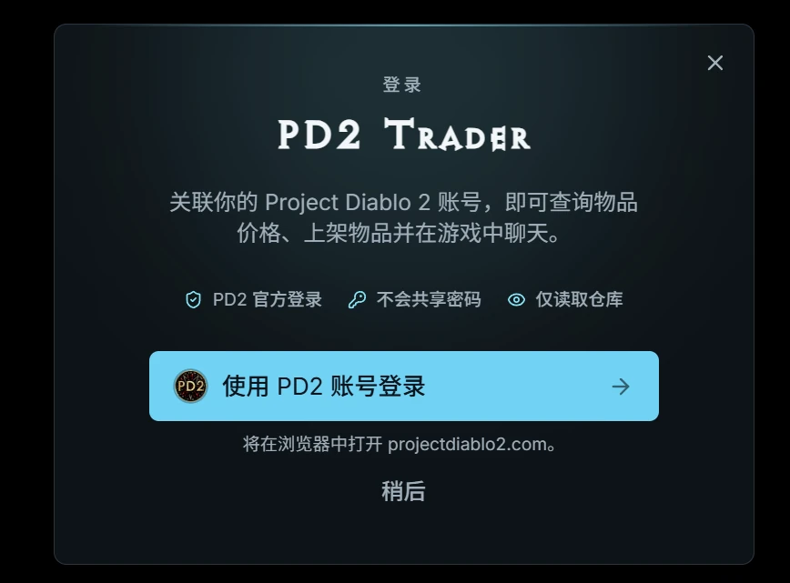
  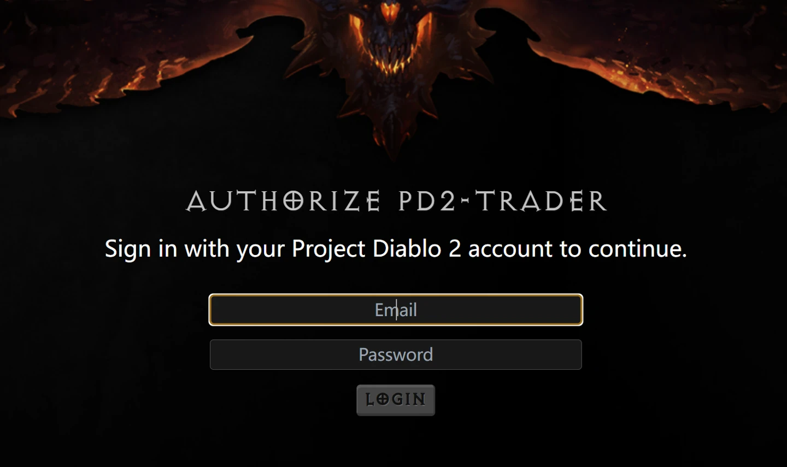
</p>

登录后，右键点击电脑右下角托盘图标，选择“设置”（旧版可能显示 Settings），在“**账户**”页确认“已登录”及关联的游戏账号。

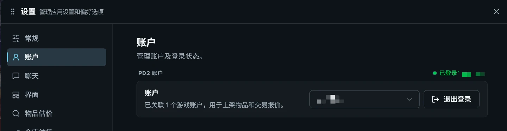

## 2. 设置游戏目录与账号分区

**打开设置：<kbd>Ctrl</kbd> + <kbd>O</kbd>，或右键托盘图标 → 设置。**

在“**常规**”中选择自己的天梯／非天梯、普通／专家模式和赛季，并将游戏目录设为实际使用的 **Diablo II 文件夹**。查询的市场分区应与游戏账号所在分区一致。

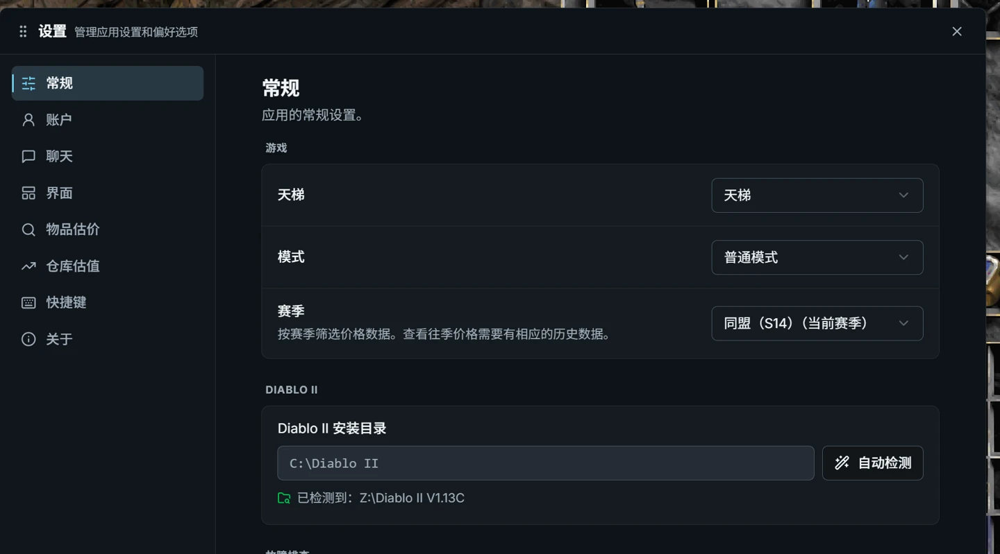

## 3. 装备查价与词缀中文化

**核心操作：游戏中鼠标指向装备，按 <kbd>Ctrl</kbd> + <kbd>D</kbd>。无需把装备穿到角色身上。**

1. 在背包、装备栏或储物箱中指向目标物品，呼出查价窗口。
2. 核对识别出的物品名、底材和品质，勾选想比较的词缀，按需调整数值范围。
3. 点击“搜索”，查看同类市场挂牌；根据需求选择是否显示过期挂牌。
4. 对比关键词缀、孔数、腐化等差异，再判断价格。自动估价和卖家挂牌价均作为参考，不代表实际成交价。

<p align="center">
  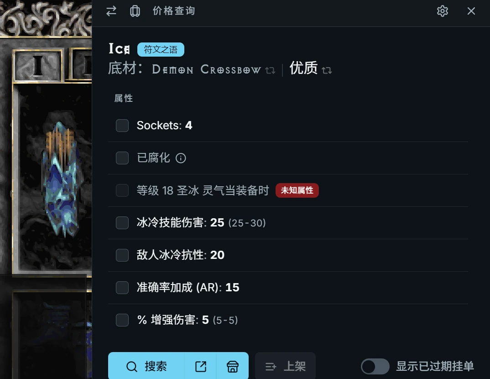
</p>

当前安装包同时支持英文和汉化客户端的装备复制数据，并修复了中文编码及部分聚气技能缺失字段导致的识别问题。物品和词缀在界面显示中文；市场查询仍使用对应的标准名称与编号。未收录的 PD2 名称可能保留英文。

## 4. 交易大厅：搜索、筛选与联系卖家

**打开交易大厅：点击游戏右下角浮窗最上方的商店图标，或按 <kbd>Ctrl</kbd> + <kbd>M</kbd>。**

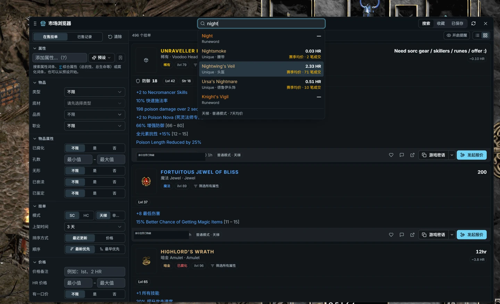

在名称栏输入想购买的物品，或用左侧筛选栏按类型、底材、品质、职业、词缀及数值范围缩小结果。核对当前赛季、模式、挂牌状态和价格条件，避免漏掉符合需求的物品。

<details>
<summary><strong>展开查看：名称搜索与左侧精确筛选示例</strong></summary>

<p>
  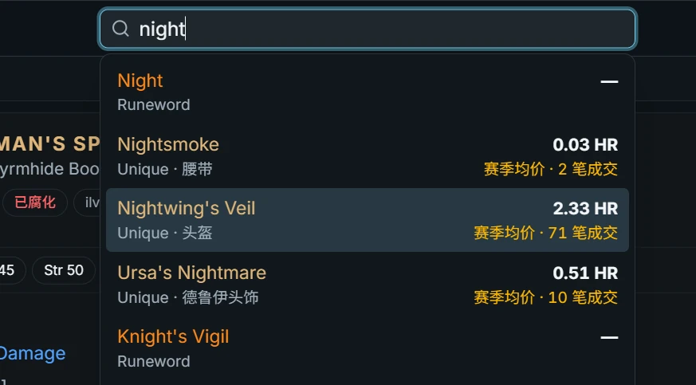
  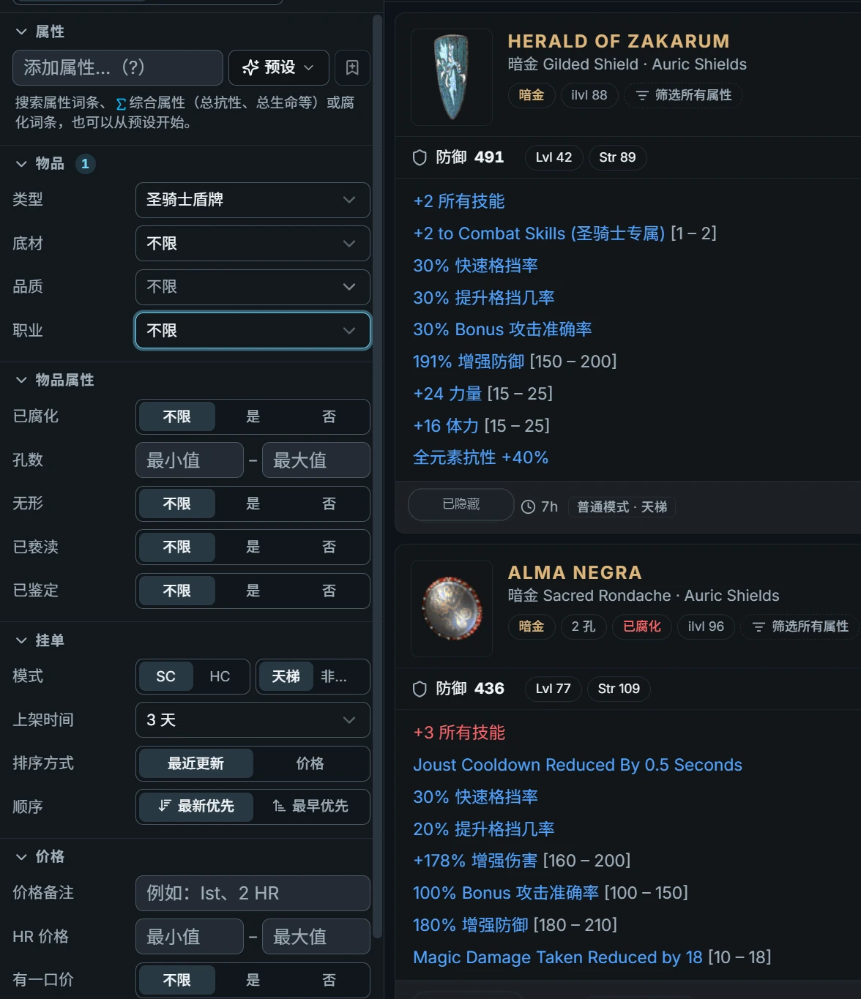
</p>

</details>

点击市场工具栏的**列表／卡片按钮**切换显示样式：列表便于浏览，卡片便于直接比较装备属性。

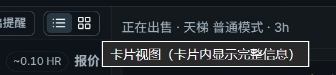

### 联系卖家并查看其他挂牌

找到目标商品后，点击“**联系卖家**”或聊天图标进入对话；使用旁边的卖家／其他挂牌入口，可继续查看这位卖家出售的商品。交易报价／买卖窗口的默认快捷键是 **<kbd>Ctrl</kbd> + <kbd>B</kbd>**。

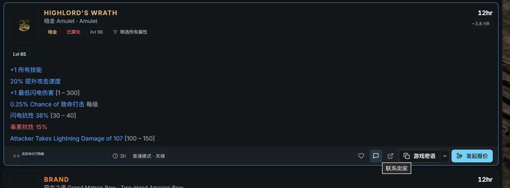

### 聊天与中英双语消息模板

**打开聊天：<kbd>Ctrl</kbd> + <kbd>T</kbd>；第二种方法：点击游戏右下角聊天浮窗。** 从市场点击“联系卖家”也可进入对应对话。

选择消息模板，或手动输入内容后发送，沟通价格、游戏房间和交易时间。

> **预设模板按钮显示中英双语，发送给对方的内容只有英文。** 手动输入或自行编辑的模板会按实际内容发送，不会自动把中文翻译成英文。

<p align="center">
  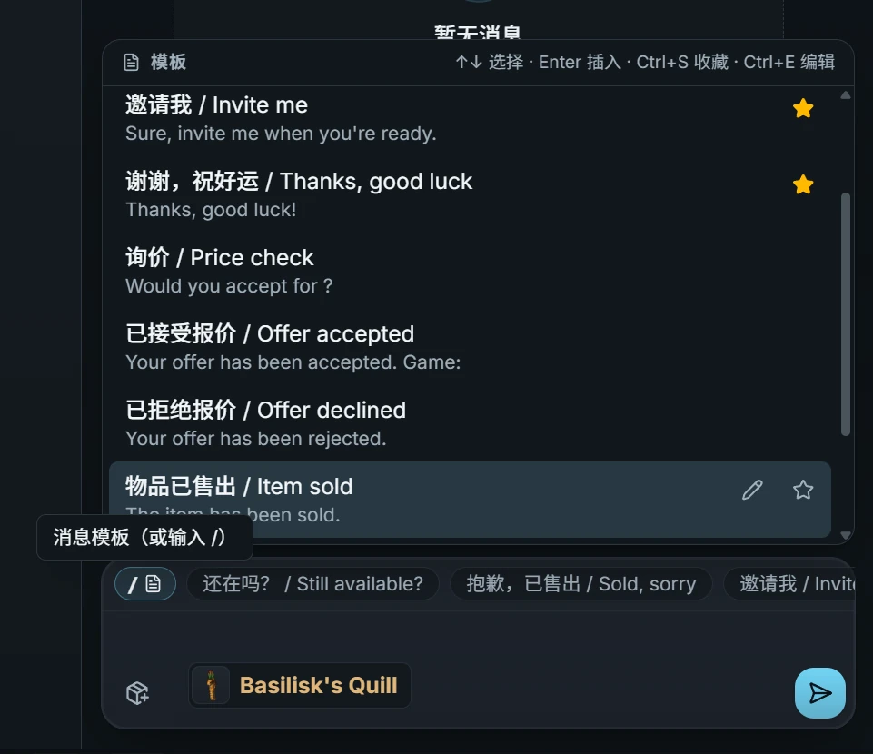
</p>

| 聊天框内操作 | 按键 |
| --- | --- |
| 打开／搜索模板 | **<kbd>/</kbd>** |
| 选择模板并插入 | **<kbd>↑</kbd> / <kbd>↓</kbd>**，再按 **<kbd>Enter</kbd>** |
| 收藏当前选中的模板 | 模板列表展开时按 **<kbd>Ctrl</kbd> + <kbd>S</kbd>** |
| 编辑当前选中的模板 | 模板列表展开时按 **<kbd>Ctrl</kbd> + <kbd>E</kbd>** |
| 发送当前消息 | **<kbd>Enter</kbd>** |
| 输入换行 | **<kbd>Shift</kbd> + <kbd>Enter</kbd>** |

### 收藏商品，稍后查看

点击商品旁的**心形图标**收藏，再切换右上角的“**收藏**”页集中查看。在卡片视图中选中挂牌且未在输入文字时，可按 **<kbd>F</kbd>** 收藏／取消收藏。

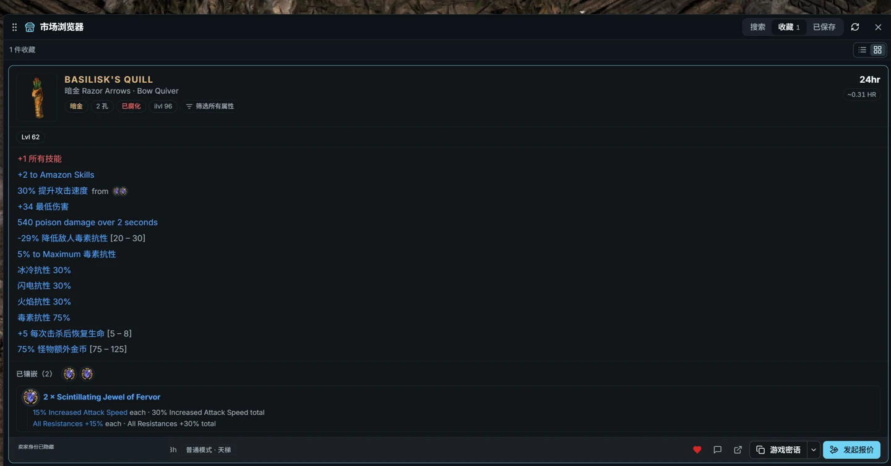

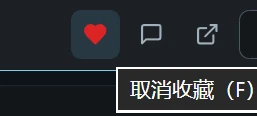

## 5. 上架与下架自己的物品

**上架：<kbd>Ctrl</kbd> + <kbd>L</kbd>　下架：<kbd>Ctrl</kbd> + <kbd>U</kbd>。**

1. 先将待售物品放入**共享储物箱**。
2. 等待官网同步数据，通常需要几分钟，实际时间取决于官网同步状态。
3. 在游戏中鼠标指向目标物品，按上架快捷键，核对物品、填写价格与备注后发布。
4. 物品售出或不再出售时，使用下架功能处理对应挂牌。

<p align="center">
  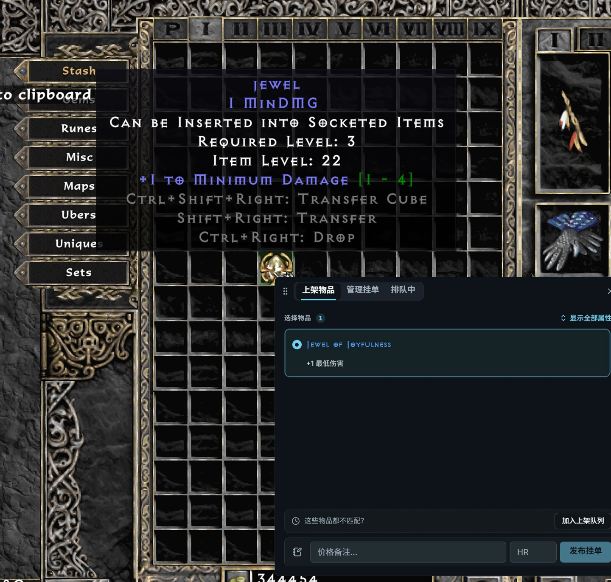
</p>

刚放入储物箱却无法找到物品时，先确认登录账号、赛季和分区，再等待官网完成同步；重复打开上架窗口不会加快官网的数据同步。

## 6. 仓库估值与财富追踪

**打开仓库估值：<kbd>Ctrl</kbd> + <kbd>X</kbd>。**

查看仓库总价值、分类占比、价值较高的物品及历史变化。结合价格来源、缺价格提示与估值置信度判断结果；仓库同步和市场价格数据会影响估值。

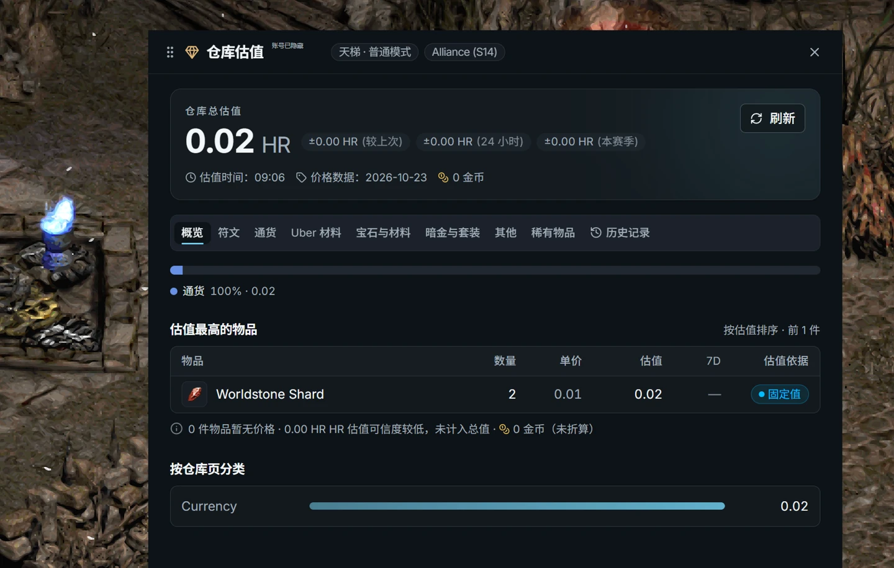

可在设置中调整追踪和快照选项。**手动快照默认没有快捷键**，如需快捷操作，请在“设置 → 快捷键”自行绑定。

## 7. 游戏浮窗、皮肤与通知

在“**设置 → 界面**”中开关游戏右下角聊天浮窗，选择主题皮肤并调整窗口透明度；透明度 **0% 表示不透明**。

<p>
  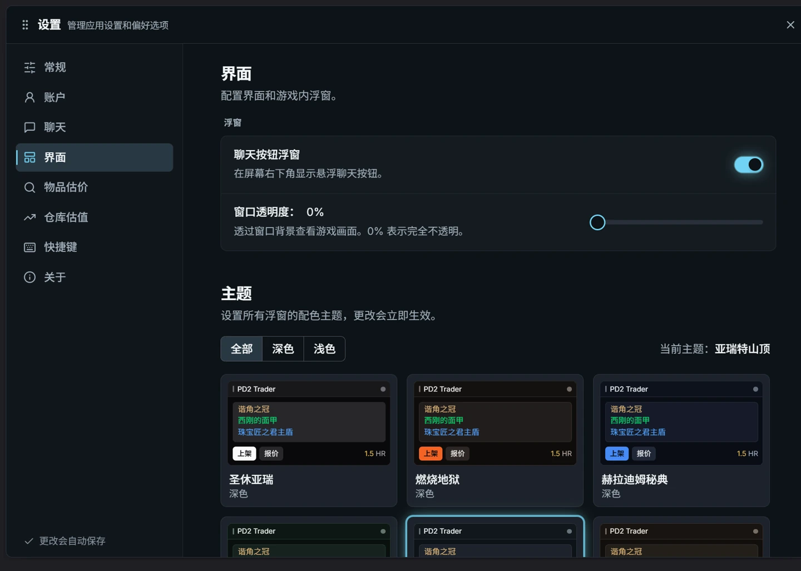
  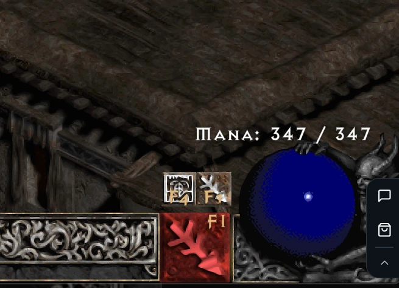
</p>

在“**设置 → 聊天**”中调整消息与交易通知的触发时机、提示音量和弹窗类型。

<details>
<summary><strong>展开查看：通知与自定义快捷键设置</strong></summary>

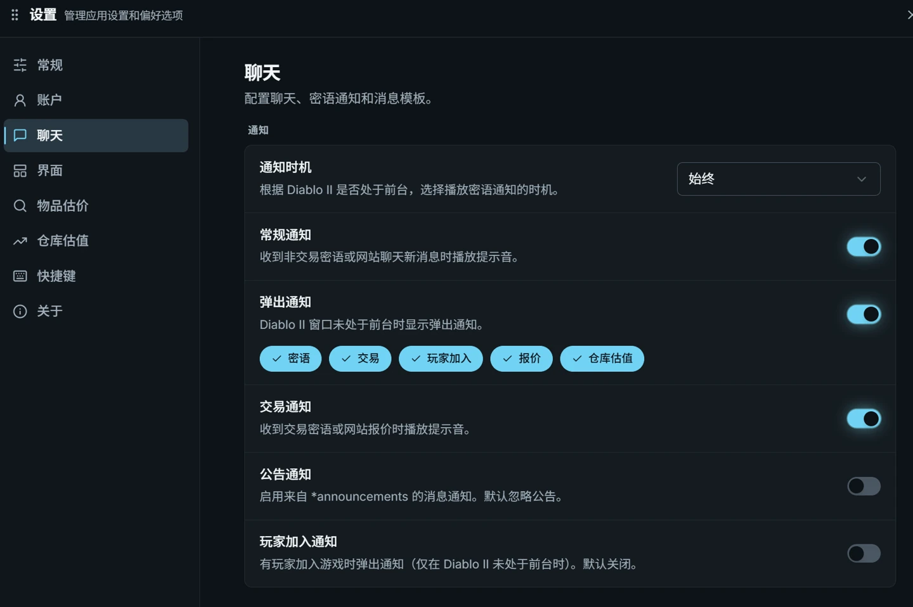

在“**设置 → 快捷键**”中修改按键。遇到按键无响应，先核对自定义值、游戏是否在前台，以及是否与其他程序的快捷键冲突。

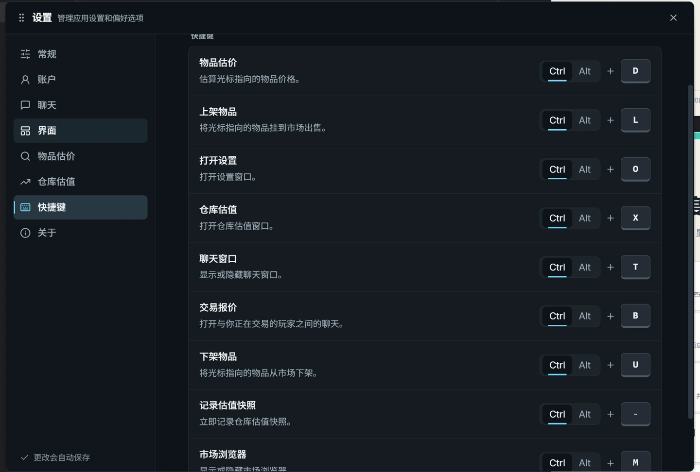

</details>

## 常见问题

| 遇到的情况 | 建议处理 |
| --- | --- |
| 英文与汉化游戏客户端需要分别安装吗？ | 不需要，同一份中文版安装包兼容两种客户端。 |
| 启动后如何进入设置？ | 右键电脑右下角托盘图标进入设置，也可按默认 Ctrl+O。 |
| 搜不到物品或结果很少？ | 核对分区、赛季、挂牌状态和词缀范围，减少条件后再搜索。 |
| 共享储物箱物品暂时无法上架？ | 核对账号及分区，并等待官网完成仓库数据同步。 |
| 个别名称仍显示英文？ | 可能是翻译资料尚未覆盖的 PD2 名称；可提交英文名及建议译名。 |
| 识别报错或其他窗口受影响？ | 到 [Issues](https://github.com/SolairsVIP/pd2-trader-chinese/issues) 提供版本、操作步骤和截图；装备识别问题可附 Ctrl+C 的原始装备文本，提交前去除个人信息。 |

## 更新记录与源码

**0.11.2：默认自动检查并提示更新，点击后安装。** 增加“设置 → 更新”页、独立签名校验和 GitHub 自动发布流程，包含 0.11.1 的技能复查修复。详见[本版说明](docs/releases/v0.11.2.md)和[自动更新维护说明](docs/自动更新维护.md)。

**0.11.1 技能复查修正：** 修复标枪技能拼写、职业技能错名与缺失编号，并校正市场技能树筛选目录。完整范围与验证结果见[技能全面复查记录](docs/技能全面复查-20261025.md)。

**0.11.0 本次重点：**修复中文装备复制乱码，补充中文底材、固定名称与技能识别，修复鬼火投射者等聚气技能装备的缺失字段报错，并整合技能和部分 PD2 暗金名称汉化。预设交易消息继续发送英文。

- [当前发布说明](docs/releases/v0.11.2.md)
- [更新专项验证记录](docs/自动更新验证-20261025.md)
- [0.11.0 兼容范围与历史校验值](docs/releases/v0.11.0.md)
- [0.11 大版本更新记录](docs/发布记录-0.11.0.md)
- [历史修复与阶段性验证记录](docs/历史修复记录.md)
- [下载 SHA-256 校验文件](https://github.com/SolairsVIP/pd2-trader-chinese/releases/download/v0.11.4/SHA256SUMS.txt)
- [上游原项目](https://github.com/errolgr/pd2-trade) · [本项目开源仓库](https://github.com/SolairsVIP/pd2-trader-chinese) · [MIT 许可证](LICENSE)

<details>
<summary><strong>开发者：从源码构建 Windows 安装包</strong></summary>

需要 Node.js、Rust 工具链和 Windows C++ 构建工具。在仓库根目录运行：

```powershell
npm ci
npm run tauri -- build --bundles nsis
```

签名安装包还需要维护者通过环境变量提供更新私钥与密码；请参见[自动更新维护说明](docs/自动更新维护.md)。普通界面开发可使用 `npm run tauri -- dev`。安装包输出目录：`src-tauri/target/release/bundle/nsis/`。

`main` 分支包含后续源码和文档更新；发布页自动提供对应标签的源码 ZIP／TAR.GZ。仓库早期的 `pd2-trader-cn-0.10.7-src.zip` 与 `.bundle` 是初始源码快照，最新内容请使用 Git 分支或发布标签。

</details>

**再次感谢 errolgr 与所有上游贡献者。祝大家 S14 赛季开荒顺利！**
